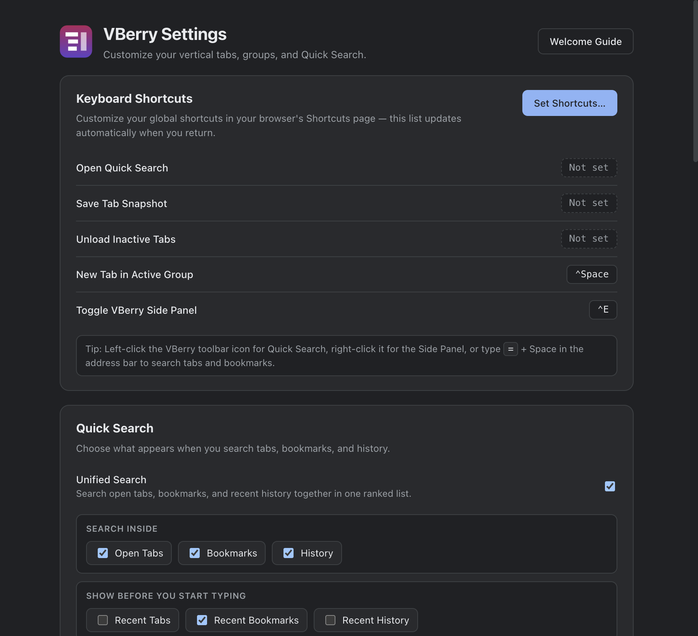

<p align="center">
  
</p>

<h1 align="center">VBerry</h1>

<p align="center">
  Vertical tab trees, color-coded tab groups, instant Quick Search, and a built-in bookmark &amp; snapshot manager for <strong>Chrome</strong> and <strong>Vivaldi</strong>.
</p>

<p align="center">
  
  &nbsp;&nbsp;
  
  &nbsp;&nbsp;
  
</p>

---

## Features

### Instant Quick Search
- **One Search for Everything**: Open the Quick Search popup from anywhere with a click or keyboard shortcut to search **Open Tabs**, **Bookmarks**, and **History** in one ranked list.
- **Ready Before You Type**: Optionally show your most recent bookmarks, tabs, or history the moment Quick Search opens.
- **Built for the Keyboard**: Start typing right away, move through matches with `↑` / `↓`, press `Enter` to open, `Tab` to switch sections, and `Esc` to clear or close.
- **Customizable Scope**: Toggle which sources appear in Unified Search, adjust how far back history is searched (`24 hours` up to `1 year` or `All time`), and choose whether to search across all tab groups or only the active one.

### Vertical Tab Trees & Groups
- **Automatic Tab Nesting**: Links opened from a page automatically nest underneath it so related tabs stay together.
- **Drag, Drop & Fold**: Reorder tabs, nest or unnest branches, collapse subtrees out of the way, and multi-select tabs (`Shift` / `Cmd` / `Ctrl`) to move, group, unload, or close them together.
- **Color-Coded Tab Groups**: Each tab group appears as a clean pill at the top alongside a dedicated pinned-tabs strip. Works seamlessly on both Chrome and Vivaldi, preserving your tab trees and groups across restarts.
- **Saved Groups & Auto-Sorting**: Pin favorite groups in Settings so they stay ready even when empty, and add website rules to automatically sort matching links into the right group.
- **Memory-Saving Unload**: Put inactive background tabs to sleep with one click or shortcut while keeping your tab tree intact.

### Built-in Bookmark Manager
- **Manage Without Leaving the Sidebar**: Browse, search, add, edit, sort A–Z, and drag-and-drop bookmarks and folders right inside VBerry.
- **Open Folders as Groups**: Right-click any bookmark folder to open all of its links together or launch them straight into a new tab group.

### History & Tab Snapshots
- **History & Recently Closed**: Quickly search recent browsing history or restore recently closed tabs and windows.
- **Tree-Preserving Snapshots**: Capture snapshots of your open windows, pinned tabs, groups, and nested tab trees manually or on a schedule. Restore a full window, a single group, or export any snapshot to Markdown.

### Easy Setup, Customization & Backup
- **Guided First-Run Welcome Page**: Walks you through setting your shortcuts, pinning VBerry to your toolbar, and getting started in under a minute.
- **Make It Yours**: Switch between Auto, Light, and Dark themes, choose Comfortable or Compact density, resize text and icons, or add Custom Sidebar CSS.
- **Backup & Import**: Export and restore VBerry backups anytime — or import existing backups and snapshots from [Sidebery](https://github.com/mbnuqw/sidebery) with colors, auto-sorting rules, settings, and custom CSS preserved.

<p align="center">
  
  &nbsp;&nbsp;
  
</p>

---

## Install & Use a Release Version

1. Download the latest `vberry-*.zip` file from the [Releases](https://github.com/justinallahyari/VBerry/releases) page and unzip it to a permanent folder on your computer.
2. Open your browser's Extensions page:
   - **Chrome**: Go to `chrome://extensions`
   - **Vivaldi**: Go to `vivaldi://extensions`
3. Turn on **Developer mode** (top-right corner).
4. Click **Load unpacked** and select the unzipped VBerry folder.
5. The **Welcome Guide** opens automatically — use it to pin VBerry and set your shortcuts.

### Everyday Controls

- **Quick Search**: Left-click the VBerry toolbar icon, or press your **Open Quick Search** shortcut.
- **Vertical Sidebar**: Right-click the VBerry toolbar icon and choose **Open VBerry Side Panel**, or press `Ctrl+E` (`Control+E` on macOS).
  - *Vivaldi users*: Click **+** in Vivaldi's sidebar and paste the Web Panel link from VBerry's Welcome Guide (`chrome-extension://<extension-id>/sidepanel.html`) to dock VBerry in your sidebar.
- **Address Bar Search (Chrome)**: Type `=` followed by `Space` in Chrome's address bar to search open tabs and bookmarks directly.
- **Right-Click Menus**: Right-click any webpage or link and choose **Send to VBerry Group** to file it away, or right-click tabs, groups, bookmarks, and snapshots inside VBerry for more actions.

### Recommended Shortcuts

Open **VBerry Settings → Set Shortcuts…** (or visit `chrome://extensions/shortcuts` / `vivaldi://extensions/shortcuts`):

| Action | Suggested / Default |
| --- | --- |
| **Open Quick Search** | Bind your favorite key (e.g., `Alt+Space` or `Ctrl+Shift+K`) |
| **Toggle VBerry Side Panel** | `Ctrl+E` (`Control+E` on macOS) |
| **New Tab in Active Group** | `Ctrl+Space` (`Control+Space` on macOS) |
| **Save Tab Snapshot** | Optional |
| **Unload Inactive Tabs** | Optional |

---

## Build from Source

Requires [Node.js](https://nodejs.org/) (v20+ recommended).

```bash
git clone https://github.com/justinallahyari/VBerry.git
cd VBerry
npm install
npm run build
```

This builds the unpacked extension into `addon/`, which you can load via **Load unpacked** in `chrome://extensions` or `vivaldi://extensions`.

Other useful scripts:

```bash
npm run package     # Build and create a release zip in dist/
npm run typecheck   # Run TypeScript checks
npm test            # Run the unit test suite
```

---

## Optional: Vivaldi CSS Hacks

If you use VBerry as a Vivaldi Web Panel and want a cleaner, edge-to-edge sidebar, check out the optional CSS mods in [`vivaldi css hacks/`](./vivaldi%20css%20hacks). They can hide Vivaldi's panel icon strip, web panel header, and extra window borders.

To enable them in Vivaldi:
1. Open `vivaldi://experiments` and enable **Allow for using CSS modifications**.
2. Open **Settings → Appearance → Custom UI Modifications**, select the [`vivaldi css hacks`](./vivaldi%20css%20hacks) folder, and restart Vivaldi.

---

## License

Licensed under the [MIT License](./LICENSE).
