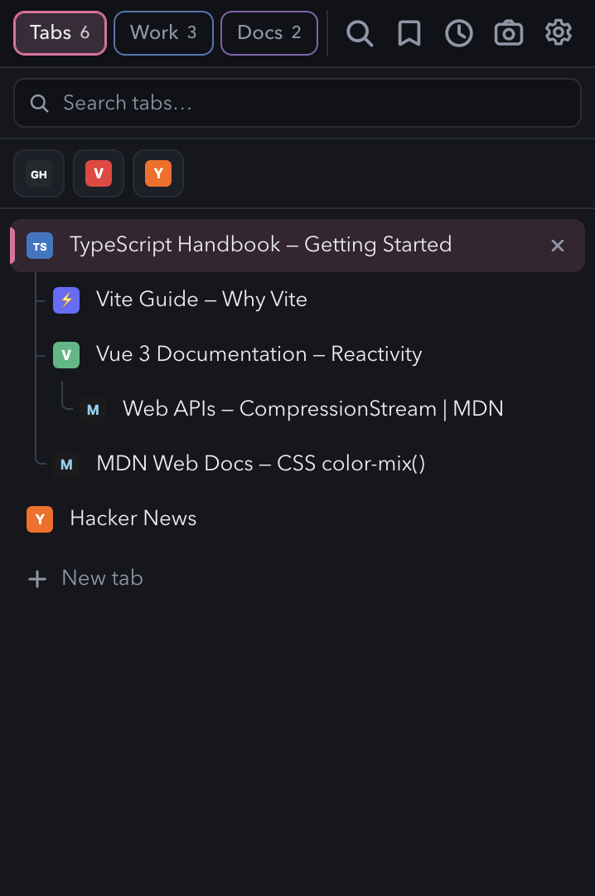
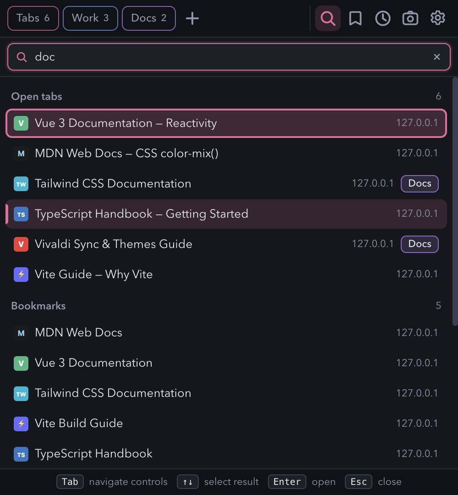
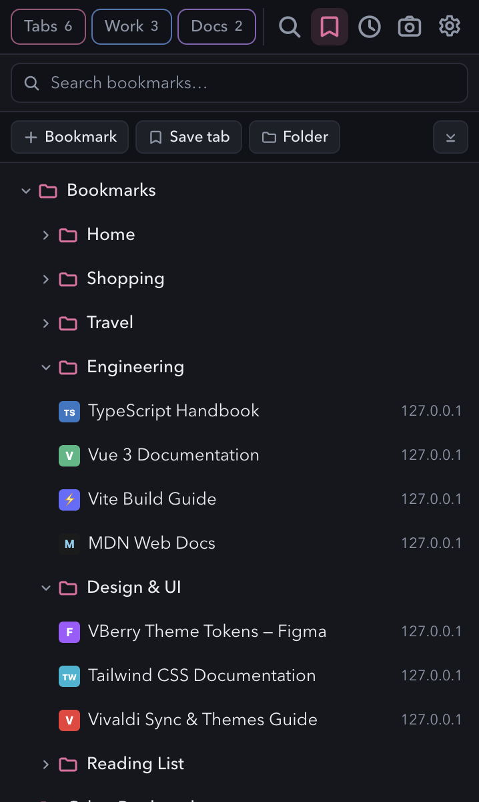
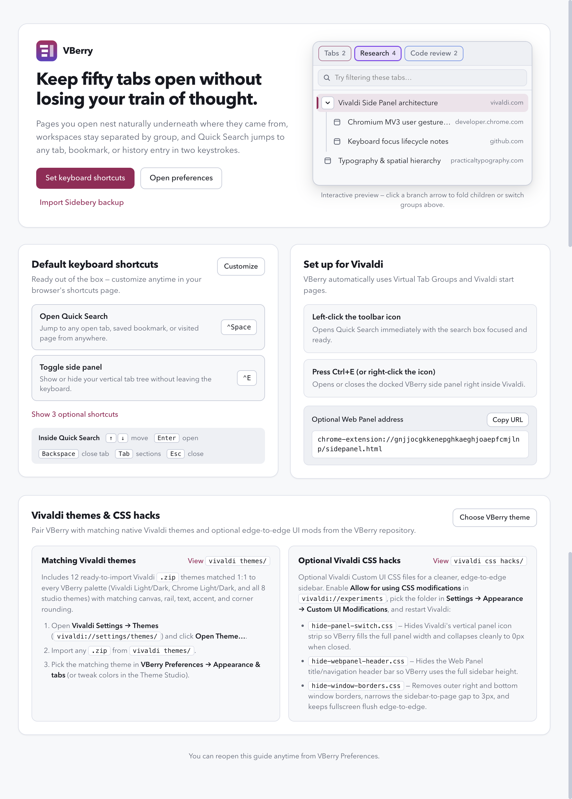
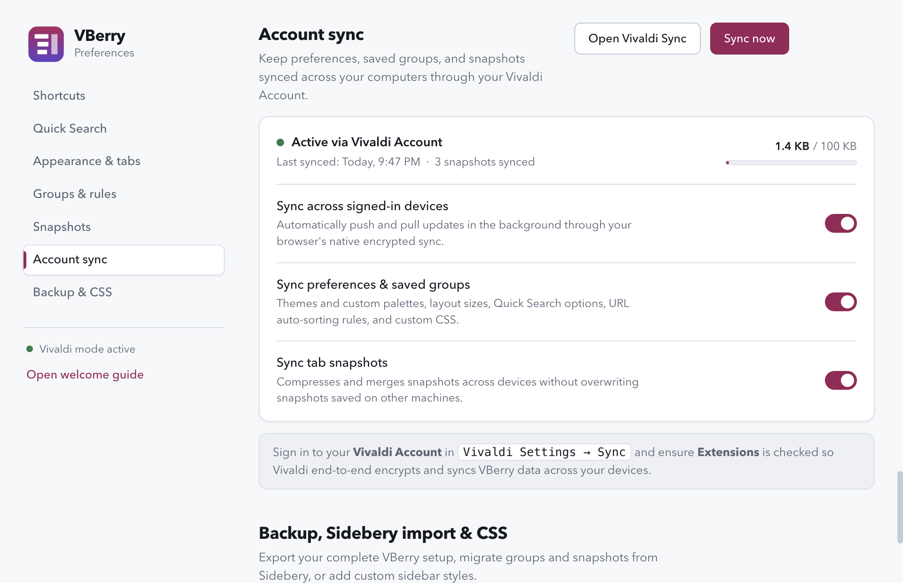

<p align="center">
  
</p>

<h1 align="center">VBerry</h1>

<p align="center">
  Vertical tab trees, color-coded tab groups, instant Quick Search, and a built-in bookmark &amp; snapshot manager for <strong>Chrome</strong> and <strong>Vivaldi</strong>.
</p>

<p align="center">
  
  &nbsp;&nbsp;
  
  &nbsp;&nbsp;
  
</p>

---

## Features

### Instant Quick Search
- **One Search for Everything**: Open the Quick Search popup from anywhere with a click or keyboard shortcut to search **Open Tabs**, **Bookmarks**, and **History** in one ranked list.
- **Ready Before You Type**: Optionally show your most recent bookmarks, tabs, or history the moment Quick Search opens.
- **Built for the Keyboard**: Start typing right away, move through matches with `↑` / `↓`, press `Enter` to open, `Tab` to switch sections, and `Esc` to clear or close.
- **Customizable Scope**: Toggle which sources appear in Unified Search, adjust how far back history is searched (`24 hours` up to `1 year` or `All time`), and choose whether to search across all tab groups or only the active one.

### Vertical Tab Trees & Groups
- **Automatic Tab Nesting**: Links opened from a page automatically nest underneath it so related tabs stay together.
- **Drag, Drop & Fold**: Reorder tabs, nest or unnest branches, collapse subtrees out of the way, and multi-select tabs (`Shift` / `Cmd` / `Ctrl`) to move, group, unload, or close them together.
- **Color-Coded Tab Groups**: Each tab group appears as a clean pill at the top alongside a dedicated pinned-tabs strip. Works seamlessly on both Chrome and Vivaldi, preserving your tab trees and groups across restarts.
- **Saved Groups & Auto-Sorting**: Pin favorite groups in Settings so they stay ready even when empty, and add website rules to automatically sort matching links into the right group.
- **Memory-Saving Unload**: Put inactive background tabs to sleep with one click or shortcut while keeping your tab tree intact.

### Built-in Bookmark Manager
- **Manage Without Leaving the Sidebar**: Browse, search, add, edit, sort A–Z, and drag-and-drop bookmarks and folders right inside VBerry.
- **Open Folders as Groups**: Right-click any bookmark folder to open all of its links together or launch them straight into a new tab group.

### History & Tab Snapshots
- **History & Recently Closed**: Quickly search recent browsing history or restore recently closed tabs and windows.
- **Tree-Preserving Snapshots**: Capture snapshots of your open windows, pinned tabs, groups, and nested tab trees manually or on a schedule. Restore a full window, a single group, or export any snapshot to Markdown.

### Easy Setup, Customization, Sync & Backup
- **Guided First-Run Welcome Page**: Walks you through setting your shortcuts, pinning VBerry to your toolbar, and getting started in under a minute.
- **Make It Yours**: Choose **Vivaldi Default** (light/dark), **Chrome Default** (light/dark), **System Auto**, or any of 8 curated studio palettes (*Mineral Slate*, *Warm Paper*, *Coastal Mist*, *Graphite Plum*, *Nordic Frost*, *Evergreen Studio*, *Midnight Indigo*, *Espresso & Brass*)—or customize any palette's colors and create your own synced custom themes right inside Preferences. Matching Vivaldi browser themes are included in [`vivaldi themes/`](./vivaldi%20themes).
- **Native Account Sync (Chrome & Vivaldi)**: Sync preferences, saved groups & URL rules, and compressed tab snapshots across your computers using your **Google Account** in Google Chrome (`Chrome Settings → Sync`) or your **Vivaldi Account** in Vivaldi (`Vivaldi Settings → Sync` with **Extensions** enabled).
- **Backup & Import**: Export and restore VBerry backups anytime — or import existing backups and snapshots from [Sidebery](https://github.com/mbnuqw/sidebery) with colors, auto-sorting rules, settings, and custom CSS preserved.

<p align="center">
  
  &nbsp;&nbsp;
  
</p>

<p align="center">
  
</p>

---

## Install & Use a Release Version

### Vivaldi (Recommended: `.crx` package)
1. Download the latest `vberry-*.crx` file from the [Releases](https://github.com/justinallahyari/VBerry/releases) page.
2. Open `vivaldi://extensions` and turn on **Developer mode** (top-right corner).
3. Drag and drop the `.crx` file onto the `vivaldi://extensions` page and click **Add extension**.
4. The **Welcome Guide** opens automatically — use it to review your shortcuts, choose a theme, and enable Vivaldi Account Sync.

### Google Chrome (Unpacked)
Chrome disables off-store `.crx` packages on macOS/Windows, so build from source below and load the `addon/` folder via `chrome://extensions` → **Developer mode** → **Load unpacked**.

### Everyday Controls

- **Quick Search**: Left-click the VBerry toolbar icon, or press `Ctrl+Space` (`Control+Space` on macOS).
- **Vertical Sidebar**: Right-click the VBerry toolbar icon and choose **Open VBerry Side Panel**, or press `Ctrl+E` (`Control+E` on macOS).
  - *Vivaldi users*: Click **+** in Vivaldi's sidebar and paste the Web Panel link from VBerry's Welcome Guide (`chrome-extension://<extension-id>/sidepanel.html`) to dock VBerry in your sidebar.
- **Address Bar Search (Chrome)**: Type `=` followed by `Space` in Chrome's address bar to search open tabs and bookmarks directly.
- **Right-Click Menus**: Right-click any webpage or link and choose **Send to VBerry Group** to file it away, or right-click tabs, groups, bookmarks, and snapshots inside VBerry for more actions.

### Recommended Shortcuts

Open **VBerry Settings → Set Shortcuts…** (or visit `chrome://extensions/shortcuts` / `vivaldi://extensions/shortcuts`):

| Action | Suggested / Default |
| --- | --- |
| **Open Quick Search** | `Ctrl+Space` (`Control+Space` on macOS) |
| **Toggle VBerry Side Panel** | `Ctrl+E` (`Control+E` on macOS) |
| **New Tab in Active Group** | Optional |
| **Save Tab Snapshot** | Optional |
| **Unload Inactive Tabs** | Optional |

---

## Build from Source

Requires [Node.js](https://nodejs.org/) (v20+ recommended).

```bash
git clone https://github.com/justinallahyari/VBerry.git
cd VBerry
npm install
npm run build
```

This builds the unpacked extension into `addon/`, which you can load via **Load unpacked** in `chrome://extensions` or `vivaldi://extensions`.

Other useful scripts:

```bash
npm run package     # Build and create a release zip in dist/
npm run typecheck   # Run TypeScript checks
npm test            # Run the unit test suite
```

---

## Vivaldi Themes & Optional CSS Hacks

### Matching Vivaldi Themes ([`vivaldi themes/`](./vivaldi%20themes))
VBerry ships with 12 ready-to-import native Vivaldi `.zip` themes paired 1:1 with every extension theme (**Vivaldi Light / Dark**, **Chrome Light / Dark**, *Mineral Slate*, *Warm Paper*, *Coastal Mist*, *Graphite Plum*, *Nordic Frost*, *Evergreen Studio*, *Midnight Indigo*, and *Espresso & Brass*). Each theme tunes Vivaldi's canvas, recessed window rail, ink foreground, highlight accent, and `8px` corner rounding so Vivaldi's chrome blends seamlessly into VBerry's Side Panel.

To install in Vivaldi:
1. Open **Vivaldi Settings → Themes** (`vivaldi://settings/themes/`) and click **Open Theme…**.
2. Select any `.zip` file from [`vivaldi themes/`](./vivaldi%20themes).
3. Select the matching theme in **VBerry Preferences → Appearance & tabs** (or customize your colors and copy the hex codes into Vivaldi's Theme Editor).

### Optional Vivaldi CSS Hacks ([`vivaldi css hacks/`](./vivaldi%20css%20hacks))
If you want a clean, edge-to-edge sidebar in Vivaldi without duplicate toolbars or thick outer borders, you can load the optional Custom UI CSS mods in [`vivaldi css hacks/`](./vivaldi%20css%20hacks):

| File | What it does |
| --- | --- |
| [`hide-panel-switch.css`](./vivaldi%20css%20hacks/hide-panel-switch.css) | Hides Vivaldi's vertical panel icon strip (`#switch`), lets the open VBerry panel expand to full width, and collapses the panel container to `0px` when closed. |
| [`hide-webpanel-header.css`](./vivaldi%20css%20hacks/hide-webpanel-header.css) | Hides the Web Panel header bar (URL title, Back/Forward/Reload/Home, Close buttons) so VBerry fills the full vertical height of the sidebar. |
| [`hide-window-borders.css`](./vivaldi%20css%20hacks/hide-window-borders.css) | Removes Vivaldi's right and bottom outer window borders/padding on the page viewport and panel container, narrows the gap between sidebar and page to `3px`, and keeps fullscreen flush edge-to-edge. |

To enable them in Vivaldi:
1. Open `vivaldi://experiments` and enable **Allow for using CSS modifications**.
2. Open **Settings → Appearance → Custom UI Modifications**, click **Select Folder…**, and pick the [`vivaldi css hacks`](./vivaldi%20css%20hacks) folder (keep only the `.css` files you want).
3. Restart Vivaldi. Use `Ctrl+E` (or Vivaldi's Panel toggle button / `F4`) to open and close the sidebar when `hide-panel-switch.css` is active.

---

## License

Licensed under the [MIT License](./LICENSE).
